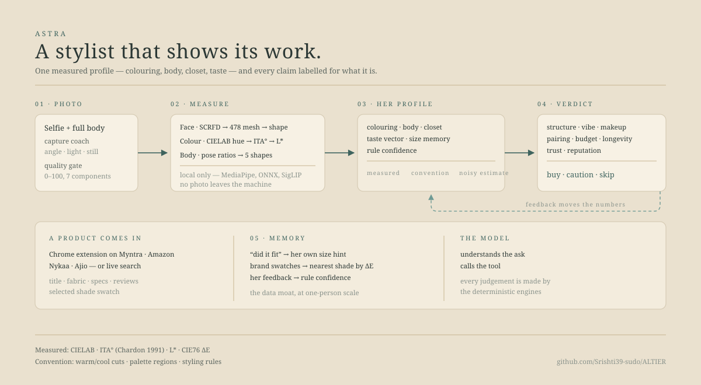

# ALTIER

**A stylist that shows its work.**

Colouring, body shape and taste measured from your own photos — then a product judged
against that profile: **buy · caution · skip**, with the reason. Every number says whether it
is measured, a cut by convention, or a guess.

[](https://github.com/Srishti39-sudo/ALTIER/actions/workflows/tests.yml)
[](LICENSE)
[](https://www.python.org/downloads/release/python-3110/)
[](#privacy)



> **Try the app:** _link_ — this repo is the source; you do not need to run it to use it.
> Running it locally is one command, see [Quickstart](#quickstart).

---

## Why this exists

Ask a fashion AI what suits you and it answers with confidence. It has no idea what your
undertone is, how long your torso is, or whether the last thing you bought in that brand
fit. It is a language model guessing at a face it has never seen.

ALTIER flips the order: **measure first, judge second, and never blur the two.**

## The four kinds of claim

This is the design decision the rest of the codebase is built around. Every output carries
its type, in the payload and in the UI — so nothing downstream has to guess what kind of
statement it is holding.

| Claim | Example | Where |
|---|---|---|
| **Measured** | undertone from the CIELAB hue angle, depth from ITA° (Chardon 1991) | `face-parsing/colorimetry.py` |
| **Measured, cut by convention** | the L\* spread is measured; the word "high/medium/low" is a cut drawn across it | `engines/contrast_engine.py`, `body_engine.py` |
| **Convention** | styling rules, palette regions — sourced, widely taught, no controlled study | `engines/rules_engine.py`, `palette_engine.py` |
| **Noisy estimate** | centimetres from a photo — always a range, never an exact size | `engines/body_engine.py` |

There is no trained model pretending to be a measurement. Where a number is uncalibrated,
it says so in the response the app renders.

Two consequences worth naming:

- **Kibbe is never auto-detected.** It is a self-select quiz. The profile column is called
  `kibbe_self_selected`, and an unprompted mention of it is treated as a hallucination.
- **Taste makes no correctness claim at all.** It is the mean of embeddings of images you
  saved — which also encodes the model, the pose, the lighting and the background.

## How it is built

Three services, one engine per file. Photos never leave the machine.

| Path | Port | Owns |
|---|---|---|
| `page1/` | FastAPI **:8000** | colour, body, face, rules, RAG, recommender · `/onboard` `/today` `/feedback` `/ask` |
| `personal_stylist/` | FastAPI **:8090** | verdict, wardrobe, outfit builder, shade match, size hint, try-on prompt |
| `backend/` | Express **:3000** | auth gateway, proxy to both FastAPI services |
| `app/` | Expo | the phone app — Today's Fit, onboarding, profile |
| `face-parsing/` | — | BiSeNet ONNX segmentation + **the one colour engine** (`colorimetry.py`) |
| `cv-service/` | — | the two modules page 1 reuses: `body_geometry.py` (MediaPipe pose) and `gemini_util.py` |

```
photo ─▶ color_engine ─▶ contrast_engine ─┐
                                          ├─▶ palette_engine ─┐
body + height ─▶ body_engine ─────────────┘                   │
                                                              ├─▶ recommender ─▶ TodayScreen
saved images ─▶ taste_engine ─────────────────────────────────┤
                                     rules_engine ────────────┘
```

`face-parsing/` is on `sys.path` at index 0 and `cv-service/` is appended, never inserted —
both define `contrast_engine.py`, and the colour engine must win. `page1/engines/_paths.py`
explains why, and `page1/tests/test_color_palette.py` asserts it.

## Quickstart

Python **3.11** (MediaPipe has no wheel for 3.12+), Node **18+**, macOS/Apple Silicon for the
GPU-side models — they run on CPU too, just slower.

```bash
git clone https://github.com/Srishti39-sudo/ALTIER.git
cd ALTIER

# page1 API
python3.11 -m venv page1/venv && source page1/venv/bin/activate
pip install -r page1/requirements.txt
cp page1/.env.example page1/.env        # every key is optional

# the colour engine's BiSeNet weights (not a pip package)
(cd face-parsing && bash download.sh)

# the styling service
python3.11 -m venv personal_stylist/venv && source personal_stylist/venv/bin/activate
pip install fastapi pydantic python-dotenv supabase requests uvicorn

./start-all.sh

# the phone app (optional — it needs the API above)
cd app && npm install
cp .env.example .env    # point it at your Mac's address on this wifi
npx expo start
```

```bash
curl http://localhost:8000/health     # page1
curl http://localhost:8090/health     # personal-stylist
curl http://localhost:3000/health     # gateway
```

Model weights download themselves on first run (~300 MB for InsightFace `buffalo_l`).
`docs/DEPLOY.md` covers reaching it from your phone (same wifi today, Tailscale next) and
calibrating the body estimate against a tape measure.

**Keys are all optional.** Without `GEMINI_API_KEY` the card still renders — the
deterministic reason is used instead of the model's phrasing. Without Supabase, profiles live
in memory and the API reports `persisted: false`. Nothing is hardcoded, and `/health` reports
whether a key is *present*, never its value.

## Tests

```bash
cd face-parsing && python test_colorimetry.py    # colour maths + round-trips (CI runs this)
cd .. && python -m page1.tests.run_all           # engines and their honesty rules
```

## Privacy

**Own hardware for anything touching face or body; a no-training API for text only.**

MediaPipe, ONNX, SigLIP and the colour maths run locally. On the free tier no photo reaches
Gemini — only text does. `page1/data/`, `profile.json`, your photos and the model weights are
git-ignored; each install builds its own.

Authentication is Supabase: the app holds the JWT and page1 applies Row-Level Security.

## Honest limits

Early, single-developer project. The things that will bite you:

- **The cuts are conventions.** Warm/cool at hue 55°/47°, depth at ITA 41/10, the five body
  shapes, the risk counts — all editorial. The axes are standards-based; where to cut is not.
- **Nothing is calibrated on returns data.** Il Makiage and True Fit are; this is not.
- **Body centimetres are a noisy estimate** and need a full-body daylight photo even to test.
- **Four retailers**, hand-written readers — not the thousands a generic extension covers.
- **No liveness check.** A photo of a screen passes the quality gate.

## Not in this repository

Her profile and photos · model weights (downloaded on first run) · "The Seasons" typeface
(commercial — the UI uses EB Garamond and falls back cleanly) · private notes.

## Contributing

Issues and PRs welcome, especially: calibrated colour thresholds, more retailer readers, and
a better body-measurement benchmark. If you change a measurement, add the test that proves
the old one was wrong.

## Licence

MIT — see [LICENSE](LICENSE). The vendored `face-parsing/` keeps its upstream licence.
